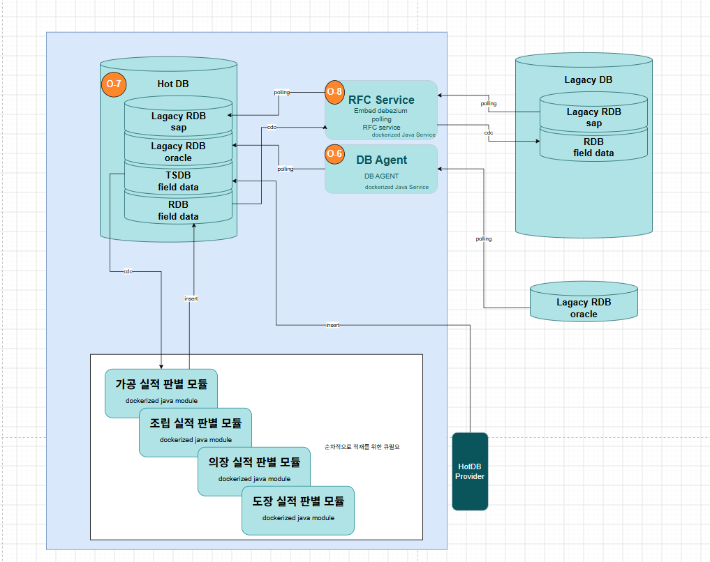

# HotDB — 파란 영역 구현 (Hot DB · 실적 판별 모듈 · RFC Service · DB Agent)

설계 근거는 [`docs/hotdb/BRD.md`](../../docs/hotdb/BRD.md). 구현 설명 · 시나리오 · 측정은
[구현 문서 (아티팩트)](https://claude.ai/artifact/GEF6mg1qMZ2PxgKkJpvZQj), 표 · 컬럼 · 필드 흐름은
[`hotdb-schema-dataflow.html`](../../docs/hotdb/hotdb-schema-dataflow.html) (브라우저로 연다).



```
field-simulator ─INSERT─▶ [tsdb] ─WAL─┬─▶ zone-mch ─┐                 가공 · 조립 · 의장 · 도장 실적 판별 모듈
 (HotDB Provider 대역)                ├─▶ zone-asm ─┤                 (같은 이미지 × 모듈 수, 모듈마다 슬롯 1)
                                      ├─▶ zone-oft ─┼─▶ [hot · ts]   통합안 · 정규화 30표 (V17): m_device_state · s_scan_* · ts.* 에 반영,
                                      └─▶ zone-pnt ─┘    │            판별 단계가 l_work_unit 앵커에 맞춰 p_progress · p_progress_block 을 쓴다
                                                         │ WAL · hot_cdc_pub = hot.p_progress
                                                         ▼
 SAP (HANA · 로컬은 sap-sim) ◀── Z 표 INSERT ── rfc-service = RFC Service (실적 CDC → SAP, ops.rfc_progress_sent 로 한 번만)
                             ──JDBC 폴링──▶ rfc-service ─▶ 레거시 DB [erp]
 레거시 사본 (inshoplocal)   ──JDBC 폴링──▶ rfc-service ─▶ Hot DB [hot.m_* · l_*]  (poll-jobs-hot.yml — 앵커 · 절점 · 부재 적재)
 Oracle (로컬은 oracle-sim)  ──JDBC 폴링──▶ db-agent = DB Agent ─▶ 레거시 DB [mes · lgs · geo]
      ▲ legacy-simulator (레거시 발행기, 시험용) — sap-sim · oracle-sim 원천 표를 10초마다 UPDATE · INSERT 해 폴링이 가져갈 변경분을 만든다

 Hot DB(필드 DB, 59433) = tsdb · hot · ts · ops   레거시 DB(59435) = erp · mes · lgs · geo · ops.poll_state
```

**서버 to 서버 배치 (2026-10-06 ~)** — Hot DB · 판별 모듈 4 · RFC Service · DB Agent · 발행기 둘 · Prometheus · Grafana 는 **서비스 PC(docker)**,
레거시 DB 사본 · SAP 대역 · Oracle 대역 · 수집기는 **레거시 서버(wssh 172.30.1.88)**. 폴링 둘과 레거시 발행기만 네트워크를 탄다.
올리는 법은 [서버 to 서버](#서버-to-서버).

## 바로 써 보기

```bash
cd src/hotdb
scripts/up-local.sh            # Mac · Linux (docker) — 한 대에 전부: Hot DB · 레거시 DB · SAP · Oracle 대역 · 서비스 · 모니터링
scripts/up-local.sh down -v    # 내리고 볼륨까지 (처음부터)
```

```powershell
cd src\hotdb
.\scripts\up.ps1 -Fast        # 빌드 + 전부 기동 (레거시 대역 · 원천 표 시드 포함). -Fast = 스캔 주기 5초
.\scripts\up.ps1 -AllZones    # 발행기가 도장 · 가공 대역 장비 30대씩도 낸다 (필드 정의서 전 가정값)
.\scripts\test.ps1            # 단위 25 + 통합 24 + 대시보드 빈 패널 검사
python scripts\legacy-sim.py mutate   # 레거시 대역 원천 몇 행을 고쳐 증분 폴링 확인
.\scripts\outage-test.ps1     # 권역 서비스를 60초 멈췄다 살려 따라잡는지
.\scripts\down.ps1 [-Volumes] # 내리기 (-Volumes 면 DB · 슬롯까지 초기화)
```

| 무엇 | 주소 |
|---|---|
| Grafana — 첫 화면 **HotDB 상태** (부하 · CDC 판정 정상/주의/이슈), 상세 **HotDB CDC** | http://localhost:59400 (admin/admin) |
| Prometheus | http://localhost:59490 |
| HotDB (필드 DB) | `localhost:59433` db `hotdb` (postgres/postgres) |
| 레거시 DB | `localhost:59435` db `legacy` (postgres/postgres) — erp · mes · lgs · geo · 폴링 상태 |
| 실적 판별 모듈 health | http://localhost:59481 (asm) · 59482 (oft) · 59483 (pnt) · 59484 (mch) `/actuator/health` |
| RFC Service health | http://localhost:59485/actuator/health — 폴링 작업 · CDC 상태 |
| DB Agent health | http://localhost:59486/actuator/health |
| SAP 대역 | `localhost:59434` db `sapsim` (sapsim/sapsim) — 원천 `erpsrc.*` · 송신 대상 `erpsrc.zhotdb_progress` |
| 레거시 사본 — SAP 출신 (hot 적재 원천) | `localhost:54433` docker `inshoplocal-pg` (inshoplocal/inshoplocal). 원본 `inshoplocal`(기준 정보 — 지우지 않는다) · 구조만 있는 빈 사본 `inshoplocal_empty`(gp · bak). RFC Service 는 `LEGACY_SRC_URL` 이 가리키는 쪽을 읽는다 |
| 레거시 사본 — Oracle 출신 (hot 적재 원천) | `localhost:59522/FREEPDB1` docker `inshoplocal-oracle` — 사용자 AM(ProSSYS 60표) · APNB(BTS 3) · SDE(GIS 1), 빈 구조. 읽기 계정 inshoplocal_reader/inshoplocal_reader (`LEGACY_ORA_URL`). `hot.m_lot` · `hot.l_event.ssy` 가 읽는다 |
| Oracle 대역 | `localhost:59521/FREEPDB1` — 원천 표 소유자 MES · LGS · GEO (64표), 읽기 계정 legacy_reader/legacy_reader, 관리자 system/hotdb_sim_sys |
| **부하 제어판** | http://localhost:59480/ — 두 발행기 배속 · 멈춤 버튼, 단계 부하 시나리오, 적재 · 반영 · 지연 · WAL 실시간 차트(Prometheus). 조작 시점이 차트에 세로선으로 찍힌다 |
| 발행기 | http://localhost:59480/sim · 배속 `POST /sim/speed?value=5` · `POST /sim/pause` |
| 레거시 발행기 | http://localhost:59493/sim — SAP · Oracle 대역 원천 표를 10초마다 바꿔(UPDATE 3 · INSERT 1) 폴링이 가져갈 변경분을 만든다. 배속 · pause 같음 |

필요한 것: podman (+ docker-compose), JDK 21 (`~/.jdks` 에 있으면 자동), Python 3.
레거시 표(erp 114 · mes 60 · lgs 3 · geo 1 = 178표)는 `scripts/gen-sample-legacy.py` 가 만든 시험용 표다 — 이름 · 컬럼 · 값은 지어냈고, 표 수 · PK · 컬럼 수만 실제 레거시와 비슷하게 맞췄다.

## 보면서 돌려 보기 (Grafana + 시뮬레이터)

`.\scripts\up.ps1` 로 띄운 뒤 브라우저로 넷을 연다.

| 창 | 주소 | 보는 것 |
|---|---|---|
| Grafana 첫 화면 **HotDB 상태** | http://localhost:59400 (admin/admin) | 맨 위 판정 13칸 — 0 정상 · 1 주의 · 2 이슈. 아래는 Hot DB CPU · 메모리 · CDC 지연 · 레거시 폴링 |
| Grafana **HotDB CDC** (상세) | http://localhost:59400/d/hotdb-cdc/hotdb-cdc | 슬롯 · WAL · 모듈별 반영 지연 · SAP 송신 · 폴링 작업별 행 수 · 발행기 배속 |
| Grafana **HotDB 엔진 자원** | http://localhost:59400/d/hotdb-engine | 아래 네 줄 — 엔진이 서비스 프로세스 안에서 쓰는 몫과 그 영향 (파이프라인 변수로 거른다) |
| 현장 발행기 (field-simulator) | http://localhost:59480/sim | tsdb 로 들어가는 장비 데이터 — 장비 수 · 초당 행 · 누적 |
| 레거시 발행기 (legacy-simulator) | http://localhost:59493/sim | SAP · Oracle 대역 원천 표 변경 — 주기 · 표마다 UPDATE · INSERT 수 · 누적 |

두 발행기는 같은 조작을 받는다 (PowerShell 에서는 `curl` 이 다른 명령이라 `curl.exe`).

```powershell
curl.exe -s localhost:59480/sim                          # 상태
curl.exe -s -X POST "localhost:59480/sim/speed?value=5"  # 배속 x5 (현장 약 2,100 행/초)
curl.exe -s -X POST localhost:59480/sim/pause            # 멈춤
curl.exe -s -X POST localhost:59480/sim/resume           # 다시
curl.exe -s -X POST "localhost:59493/sim/speed?value=3"  # 레거시 발행기 배속 x3 (주기 10초 → 약 3.3초)
curl.exe -s -X POST localhost:59493/sim/tick             # 레거시 발행기 한 주기를 지금 바로
```

해 볼 만한 것과 Grafana 에서 보이는 것:

| 해 보기 | 기대 |
|---|---|
| 현장 발행기 배속 x5 | **HotDB CDC** 의 적재 행/초가 5배, 모듈 반영 지연 p99 가 조금 오르고 판정은 정상 유지 |
| 현장 발행기 pause 2분 | 적재 0. heartbeat 가 있어 CDC 판정은 정상 (멈춘 건 원천이지 CDC 가 아니다) |
| `podman stop hotdb-zone-oft`, 1분 뒤 `podman start hotdb-zone-oft` | 판정 02 · 03 · 06 이 이슈 → 다시 정상. 멈춘 사이 쌓인 WAL 을 따라잡는다 (`scripts\outage-test.ps1` 이 자동으로) |
| 레거시 발행기 tick · 배속 | 폴링 작업별 행 수가 오르고 판정 09 정상. 원천 = 레거시 DB 인지는 `scripts\test.ps1` (OraclePollIT · RfcServiceSapIT) |
| `podman stop hotdb-legacy-db`, 뒤에 start | 판정 12 레거시 DB 접속 · 09 레거시 폴링이 이슈. start 하면 다음 주기에 밀린 변경분을 가져온다 |

### 엔진 자원 — Embedded 엔진이 서비스 프로세스 안에서

**HotDB 엔진 자원** 대시보드의 네 줄이 네 질문에 답한다.

| 줄 | 질문 | 보는 지표 |
|---|---|---|
| ① 엔진 자원 | 엔진이 프로세스 CPU · 메모리 · 스레드를 얼마나 쓰나 (평시 · 1만 건 배치 · 적체) | `hotdb_cdc_engine_cpu/alloc{part=engine\|handler\|process}` · `hotdb_cdc_engine_threads` · 힙 · GC |
| ② 상호 영향 | 본연의 일(라우트 반영 · 판정 · RFC 전달 · 폴링)과 캡처가 자원을 다툴 때 서로 밀리나 | `hotdb_work_*{part=judge\|poll}` 와 엔진 CPU 나란히 · 캡처 지연 · 배치 반영 p99 · 판정 대기 · RFC 2단 지연 · 폴링 주기 |
| ③ 원천 DB 부하 | 슬롯이 WAL 을 얼마나 붙잡나, 소비자가 얼마나 오래 멈춰도 되나 | 슬롯 보존 WAL vs `max_slot_wal_keep_size` · `pg_wal` 크기 · 디스크 여유 · **다운 허용 시간** = 남은 여유 / WAL 속도 |
| ④ 적체 | 밀릴 때 메모리 상한이 지켜지나, backpressure 가 도나 | 엔진 큐 건수 · 바이트 사용률 · 힙 vs `-Xmx` · 슬롯 미확인 WAL |

- 본연의 일 스레드는 `WorkThreads.factory("<part>", …)` 로 만들면 엔진과 같은 방식으로 따로 센다 (판정 `judge` · 폴링 `poll`).
  배치 콜백(라우트 반영 · RFC 전달)은 엔진 스레드 위에서 돌아 `handler` 로 잡힌다
- 적체 때 메모리는 엔진 큐에서 묶인다 — `max-queue-size`(8192건) · `max-queue-size-bytes`(zone 64MB · rfc 32MB). 큐가 차면
  엔진이 슬롯 읽기를 멈추고 밀린 것은 원천 WAL 에 남는다. ④ 에서 큐 사용률이 1 에 붙어 있는 동안 힙이 평평하고 슬롯 미확인 WAL 이
  오르면 backpressure 가 도는 것이다
- 다운 허용 시간은 "지금 WAL 속도로 소비자가 멈추면" 이다. 디스크 쪽이 슬롯 쪽보다 짧으면 슬롯 무효화 전에 디스크가 차서 DB 가 멈춘다.
  디스크는 node-exporter 대상 중 라벨 `hotdb_db="1"` 인 서버의 `/` 로 본다 (`up.ps1` · `up-services.sh` 가 붙인다)
- 경보: `CdcEngineBackpressure`(큐 90% 5분) · `CdcDowntimeBudgetLow`(다운 허용 1시간 미만) · `HotdbDiskBelowSlotCap`(디스크 여유 < 슬롯 상한)
- 세 시나리오를 실제로 재려면 `python scripts/engine-resource.py all` — 구간마다 Grafana 주석(tag `engine-resource`)을 남겨
  그래프 위에 평시 · 배치 · 적체 띠가 보인다. 힙의 엔진 몫은 엔진을 끈 쌍둥이와의 차이로 `summary.json` 에 나온다

## 구성

| 경로 | 내용 |
|---|---|
| `db/migration/V*.sql` | Hot DB Flyway 마이그레이션 — 계정 · 스키마 · tsdb · publication · 모듈 등록부(V7) · 레거시 분리(V10) · **통합안 · 정규화 30표(V17)** |
| `db/legacy-db/V*.sql` | 레거시 DB — 계정 · 폴링 상태(V1) · 시험용 사본 표 178개(V2, `scripts/gen-sample-legacy.py` 생성) |
| `app/cdc-core` | CDC 포트(`port.CdcSource` 입력 · `port.CdcSink` 출력) · Debezium 어댑터(`adapter.debezium`, `hotdb.cdc.adapter` 로 선택) · 청크 → 하이퍼테이블 역매핑 · 설정 기반 라우팅 · JDBC 반영 |
| `app/poll-core` | 레거시 폴링 라이브러리 — 원천 표 → 레거시 DB 표, 워터마크 증분 · 설정의 작업 목록만 |
| `app/zone-service` | 실적 판별 모듈. CDC 반영은 설정(`application.yml` 의 `hotdb.routes`)만, 판별은 `judge` 패키지(센서 판별 `JudgementWorker` · 절점 판별 `CheckpointWorker`). `ZONE` 으로 모듈 선택 |
| `app/rfc-service` | RFC Service (O-8) — ① SAP 폴링 → erp 114표 전부 (poll-core, `poll-jobs.yml`) ② 레거시 사본 → `hot.m_*` · `l_*` 적재 (`poll-jobs-hot.yml`, 대상 `hot`) ③ `hot.p_progress` CDC → SAP (`ProgressRelay`). SAP 송신은 `RfcSender` — `jdbc`(Z 표 `zhotdb_progress`) · `dry-run` |
| `app/db-agent` | DB Agent (O-6) — Oracle 폴링 → mes · lgs · geo 64표 전부 (poll-core). 작업 목록 `poll-jobs.yml` 은 `scripts/gen-sample-legacy.py` 가 만든다 |
| `compose.legacy-sim.yml` · `scripts/legacy-sim.py` | 로컬 검증용 SAP 대역(PostgreSQL) · Oracle 대역(oracle-free 23) · 원천 표 시드 · 레거시 발행기 |
| `app/field-simulator` | 카탈로그 기준 3채널 · 350대 발행기 (×1 ≈ 426 행/초) |
| `app/legacy-simulator` | 레거시 발행기 — 대역 원천 표를 JDBC 메타데이터로 읽어 주기마다 UPDATE(워터마크 = 지금) · INSERT. 운영에서는 안 띄운다 |
| `app/hotdb-migrate` | Flyway 실행기 |
| `compose.*.yml` | 서버 역할별로 나눈 compose — 서버 to 서버 배치 그대로 |
| `monitoring/` | Prometheus · Grafana · postgres_exporter 쿼리 · 경보 |

## 스키마가 바뀌면

1. `db/migration` 에 **새** V 파일을 더한다 (이미 적용된 V 파일은 고치지 않는다 — 체크섬이 바뀌면 Flyway 가 거부한다)
2. 영향받는 라우트의 `columns` 를 `app/zone-service/src/main/resources/application.yml` 에서 고친다
3. `.\scripts\up.ps1` — 마이그레이션이 새 파일만 적용하고, 서비스가 기동 때 라우트를 실제 표와 대조한다

라우트가 표와 어긋나면 서비스는 **어긋난 곳을 전부 모아 보여 주고 기동을 거부한다**(조용히 null 을 쓰며 돌지 않는다):

```
라우트 설정이 DB 스키마와 맞지 않습니다 (2건)
  - 라우트 'device-state': 대상 hot.m_device_state 에 컬럼 humidity 가 없습니다 (있는 것: [...])
  - 라우트 'device-state': 원천 tsdb.status_history 에 컬럼 state 가 없습니다
```

원천 컬럼을 먼저 지우고 서비스를 나중에 배포하는 순서라면 `hotdb.cdc.strict-source: false` 로 원천 쪽은 경고만 낸다.

### 라우트 문법

```yaml
- name: scan                                  # 지표 · dead letter 에 찍히는 이름
  source: tsdb.actual_history                 # 원천 논리 표 (청크 이름은 cdc-core 가 되돌린다)
  lookups: { tag: row.tag_key }               # 참조 캐시 붙이기 → tag.* 로 읽는다
  when: [ "tag.zone=${hotdb.zone.code}", "row.event_type=START|COMPLETE" ]
  target: ${hotdb.zone.schema}.scan
  mode: upsert                                # upsert · insert · insert-on-change · delete
  keys: [ scan_id ]
  newer-than: last_event_at                   # 더 새 이벤트만 덮어쓴다 (재전송 · 순서 뒤바뀜 방어)
  lag-from: row.received_at                   # 지연 지표 기준
  columns:
    first_event_at: row.event_time | keep     # 충돌 시 기존 값 유지
    completed_at: row.event_time if row.event_type=COMPLETE | coalesce
    applied_at: $now                          # DB clock_timestamp()
```

식: `row.x` · `before.x` · `<lookup>.x` · `meta.lsn|op|table|commit_time` · `'상수'` · 숫자 · `null` · `$now` · `식 if 조건` · `식 if 조건 else 식`.
조건: `a=v1|v2` · `a!=v` · `a is null` · `a not null`. 값은 `CAST(? AS <대상 컬럼 실제 타입>)` 으로 들어가므로
대상 컬럼 타입을 바꿔도 코드는 그대로다.

새 권역 표 · 새 원천 표도 라우트 한 블록이면 된다. 판별 로직처럼 설정으로 안 되는 것만 서비스에 코드를 더한다.

## 실적 판별

두 단계가 같은 프로세스의 다른 스레드로 돈다. 둘 다 CDC 반영(엔진 스레드)과 떨어져 있어 판정이 느리거나 규칙이 터져도 슬롯은 밀리지 않는다.

**센서 판별** (`JudgementWorker`, 스레드 `judge-<모듈>`) — 라우트는 인식 객체(`hot.s_scan_detection`)를 `judged = false` 로 넣기만 한다.
1초마다 자기 모듈 회차(`s_scan_session.zone`)의 것을 오래된 것부터 최대 200건 `FOR UPDATE SKIP LOCKED` 로 집는다.

- 규칙 → `DONE` · `IN_PROGRESS` · `LOW_CONFIDENCE`. 기본은 `hotdb.judge.threshold`(정합도 ≥ 0.9 를 넘으면 판정에 쓰고, 진척률 ≥ 100 이면 DONE)
- 앵커 매칭 — 같은 호선 · 블록 · 이 공종의 앵커 유형(`ops.module.trade` → `l_work_unit.anchor_type`)을 찾는다.
  1개면 `p_progress`(앵커 × 인식일) + `p_progress_block`, 여럿이면 블록 롤업만(`BLOCK_ONLY`), 0개면 앵커를 기다린다(`WAIT_ANCHOR`, V20) — 기다림이 끝나면 알림 `UNMATCHED`
- DONE 인데 앵커의 레거시 W/O 가 착수 전이면 `held` — 판별 O / 레거시 X → 완료 처리 금지 (ASM-F10)
- LOW_CONFIDENCE 는 실적 대신 알림(`p_action LOW_CONFIDENCE`)
- 끝나면 `s_scan_detection` 에 `anchor_id · judged · judged_ts · judge_note` 를 적는다. 라우트가 이 열들을 `keep` 으로 써서 재전송이 되돌리지 않는다
- 지표: `hotdb_judge_judged_total{status}` · `hotdb_judge_pending` · `hotdb_judge_pending_oldest_seconds` · `hotdb_judge_failed_total`

**절점 판별** (`CheckpointWorker`, 가공 모듈이 `hotdb.judge.checkpoint.enabled` 로 켠다) — 가공은 센서가 아니라 레거시 절점으로 실적을 판정한다.
30초마다 목록 모수(절단계획 ±30일, `m_code TRADE_RULE attrs.list_window_days`) 안의 DWG 앵커 중 오늘 행이 없거나 사건 · 부재가 바뀐 것을 최대 500개 다시 본다.

- 절점은 `m_code CHECKPOINT`(가공 10개: 입고 → 선별 1 · 2차 → 불출 → 전처리 → 마킹 · 절단 → 곡가공 → 모둠 → 부재 불출, 사상은 보류).
  `attrs.basis` 가 분모 — MAT(자재, 1~4) · DWG(도면, 5~7) 은 `l_event` 의 사건 시각으로, PART(부재, 8~10) 는 `l_cut_part` 의 대상 부재가 전부 끝나야 도달
- 사외 절단 도면(`site = OUT`)은 적치 절점 해당 없음, 긴급 불출은 선별 절점 생략이 정상 경로, 앞 절점 없이 뒤 절점이 찍히면 알림 `ORDER_REVERSED`
- 기록 묶음(`attrs.record_group` — YARD = ProSSYS 입고 · 선별, LINE = 140M 불출 · 전처리)에 이 도면의 기록이 하나도 없으면 그 묶음 절점은 해당 없음(`cp_stats.no_record`). 원천에 기록이 없는 것이지 순서가 뒤집힌 것이 아니다. 묶음에 기록이 하나라도 있으면 빈 절점은 순서 위반
- `p_progress`: `last_cp · state(notDue/inProgress/done) · auto_pct(절점 기준) · legacy_pct(CT·CM W/O 누계) · cp_history · cp_stats`
- `p_progress_block`(블록 × 가공 × CUT × 오늘): 시수 가중 도면 완료율 = 공식 가공 실적률 (`weight_basis DWG_MH`)
- `cp_plan · late_cp_cnt`: 마킹 = 절단계획일, 절단 완료 = 절단완료 계획일(YPWC310M cut_cmp_pln_date) 과 늦은 절점 수. 반입예정일(`l_event CARY_DUE`)이 지났는데 불출 전이면 알림 `CARRY_OVERDUE`
- 순수 함수 `CheckpointEvaluator` 가 판정을 다 들고 있다 — DB 없이 단위 테스트로 규칙을 확인한다

**조립 W/O 매칭** (센서 판별 안, 조립만) — 앵커(송선) 하나를 고른 뒤 하위 W/O 와 맞춘다 (ASM-F09).
인식일이 계획 기간에 드는 W/O(하루치, W/O 번호 15번째 글자 F = 취부 우선) → `DAY`, 앵커 계획이 인식일 ±28일(`TRADE_RULE S attrs.match_week_days`) 안 → `WEEK4`,
둘 다 아니면 `match_state MISMATCH` + 알림 `WO_MISMATCH`. `p_progress.match_pool · match_wo_no · match_lead(EARLY · ON_TIME · LATE)` 에 남긴다.
`location_id` 는 앵커 작업장이 `m_location` 에 있을 때만 적고, 블록 행에는 열린 알림 수 · BTS 지번을 같이 적는다.

**레거시 실적 판별** (`LegacyProgressWorker`, 도장 · 의장 모듈이 `hotdb.judge.legacy.enabled` 로 켠다) — 센서는 블록 단위까지라, 공식 실적 산식은 레거시 적재 표로 낸다.
60초마다 계획이 목록 모수(±30일)에 걸친 앵커 중 오늘 레거시 판정이 없거나 10분(`refresh-minutes`)이 지난 것을 최대 500개 본다.

- 도장(PAINT_ORDER): `legacy_pct` = Σ`l_wo_daily.daily_mh`(하위 W/O, MP B · P) ÷ `target_qty`(Σ212 ACTY_MH_1 공정당 1회). 2378-154 → 3331 ÷ 4002 = 83.2. `cp_stats.kinds` = 도장 요소 종류별 공정율
- 의장(GDO): `auto_pct` = Σ설치 ÷ Σ소요(`l_outfit_item`), `legacy_pct` = 같은 액티비티 W/O 진척(시수 가중). 차이가 10%p(`gap_alert_pct`) 넘으면 `gap_alert` + 알림 `GAP`. 품목마다 `p_item_state`(INSTALLED · FIXED · TEMP · ISSUED · WAITING)
- 센서 판별이 이미 쓴 오늘 행(evidence 있음)은 auto_pct · state 를 그대로 두고 legacy_pct · gap 만 채운다
- 블록 × 단계 롤업(`p_progress_block`): 의장은 GDO 의 Stage 별, 가중치 W/O 시수(하나라도 없으면 품목 수), 도장은 212 시수
- 순수 함수 `LegacyRules` (W/O 매칭 · 도장 실적률 · 품목 상태 · 차이) — 단위 테스트 `LegacyRulesTest`

규칙은 모듈마다 다르게 둘 수 있다. 모듈 전용 규칙은 프로필(= `ZONE`)을 붙인 빈 하나다:

```java
@Component @Profile("pnt")
class PaintRule implements JudgementRule {
    public Verdict judge(Detection d) { ... return Verdict.DONE; }
}
```

판정을 끄려면 `JUDGE_ENABLED=false` (인식 객체는 judged = false 로만 남는다). 절점 판별은 `JUDGE_CHECKPOINT_ENABLED=false`, 레거시 실적 판별은 `JUDGE_LEGACY_ENABLED=false`.

## 통합안 · 정규화 (V17, 2026-10-23)

Hot DB 의 모듈 RDB(svc)를 「내업 · 필드 데이터 계보」 **통합안 · 정규화** 탭의 30표로 바꿨다
(근거 https://claude.ai/artifact/VJADJkWmFYzKiwFqP9mjVQ — v9 25표 + l_event + 정규화 신규 4표).

| 영역 | 표 | 쓰는 주체 | 채우는 길 |
|---|---|---|---|
| `hot.m_*` 마스터 12 | m_hull · m_block · m_location · m_lot · m_device · **m_device_state** · m_signal_def · **m_signal_code** · **m_signal_override** · m_file_store · m_cad_file · m_code | 판별 모듈(장비 · 상태) · RFC Service(호선 · 블록 · 코드 · 지번 · 위치) | tsdb.device 라우트 · 레거시 적재 · V17 사전(TRADE · ANCHOR_TYPE · CHECKPOINT · EVENT · TRADE_RULE · SITE · EXCLUDE_REASON · CONF …) |
| `hot.l_*` 레거시 참조 9 | **l_work_unit**(작업 단위 + 네 공종 앵커 1행) · **l_event**(앵커 × 사건 × 원천 × 시각) · l_wo_daily · l_assy_node · l_cut_part · l_outfit_item · l_paint_element · l_bts_move · l_daily_plan | RFC Service | `poll-jobs-hot.yml` 24 작업 — 원천 inshoplocal(gp.*) + inshoplocal-oracle(AM · APNB · SDE) |
| `hot.s_*` 스캔 3 | s_scan_session · **s_scan_device** · s_scan_detection | 판별 모듈 | tsdb.actual_history · artifact_history 라우트 |
| `ts.*` 시계열 2 | device_signal · sensor_event (청크는 `ts_chunks`) | 판별 모듈 (Provider 도 쓸 수 있다) | status · actual 라우트 |
| `hot.p_*` 실적 · 판별 4 | p_progress · p_progress_block · p_item_state · p_action | 판별 모듈 | 센서 판별 · 절점 판별 |

- 앵커 = `l_work_unit` 에서 `anchor_type` 이 있는 행 — DWG(도면, YPWC310M) · WSTG(송선, YPWG411M flag S 의 액티비티‖송선) · GDO(ZPPT200 오더) · PAINT_ORDER(호선‖블록‖P). 모든 앵커 참조(p_*, s_scan_detection)는 `l_work_unit.unit_id` 를 가리킨다
- 설계에 없는데 더한 열: `m_device.zone` · `m_device_state.src_received_at` · `s_scan_session.zone` · `s_scan_detection.judge_note` · `ops.module.trade`. geometry 는 jsonb. 이유는 V17 머리말
- 일부러 안 건 FK: 레거시 적재 표끼리(호선 · 블록 · 도면 · W/O) — 폴링 작업이 독립으로 돌아 순서를 보장할 수 없다. `hot.v_l_orphans` 로 대조한다
- 아직 못 채우는 것: l_daily_plan(출처 미확인) · m_location ZONE(구역 등록 대기) · STEEL_SECURED(ZPPT005_1.AEFLG 가 덤프에서 빈값) · sort_ts(YPDG355M 운영 추출 뒤)
- **V18 (2026-10-24, 계보 대조 보강)**: BTS 현재 위치는 `l_bts_move`(APNB.NB202M 도착마다 1행)에만 적재하고, 트리거가 이미 있는 블록의 `m_block.bts_lot · bts_at` 을 맞춘다(지번 FK 는 논리 FK 로).
  적재 보강 — 조립 송선 목표 개수(050M 송선 = 조립 ‖ 다음 송선) · 생산 송선(0 → 54%) · 상위 노드(040M) · 계열(ZPDTB118) · GDO 대표 오더만 앵커 · 도장 목표 Σ212 공정당 1회 ·
  부재 도면(090M > 002M > 821M > 800M) · 절단 완료 상속(310M · WO_CT) · 의장 설치일(W033) · 불출(031 · 072) · 도장 일별 지시(710M) · W/O 시수 분개(ZPPT052) · 호선 선종 · 상태(ZCOT001)
- **V20 (2026-10-25, 누락 개선 — 계보 아티팩트 「개선안」 탭)**
  - F1 앵커보다 센서 실적이 먼저 오면 `WAIT_ANCHOR` 로 기다린다(`s_scan_detection.match_attempts · match_wait_until`, TRADE_RULE `anchor_wait_days` 7). 그 블록에 앵커가 적재되면 다시 판정, 기다림이 끝나면 UNMATCHED 확정 + 알림
  - F2 센서 실적의 기준일(`as_of`)은 인식 시각(Asia/Seoul)의 날짜
  - F3 SAP 송신 기록 키 = (앵커, 기준일, 내용 해시 `payload_hash`). 같은 상태에서 진척이 바뀌어도 다시 보낸다. SAP Z 표도 같은 키로 이력을 쌓고, SAP 는 마지막 `sent_at` 행을 읽는다
  - F4 l_* 8표에 `src_job · polled_at · src_deleted_at`. 열이 있으면 poll-core 가 채우고, `mark-missing: true` 인 full 작업이 이번 실행에 안 온 행에 `src_deleted_at` 을 찍는다(다시 나타나면 풀린다). 판별은 지워진 행을 빼고, 지워진 앵커의 실적은 `excluded · SOURCE_DELETED`, 의장 품목 상태는 `SOURCE_DELETED`
  - F5 증분 작업 넷(W/O · 일별 실적 · 310M · WO_CT)에 하루 1회 전체 재동기화 짝 `*.resync` (같은 `scope`, 기동 때도 한 번)
- **시험 데이터 쌓기 (로컬)**: `scripts/legacy-feed.sh` 가 원본 inshoplocal 에서 블록 하나씩 골라 빈 사본(inshoplocal_empty)으로 옮긴다(원본은 읽기만, 이미 있는 블록 · 행은 건너뜀).
  필드 발행기는 `SIM_BLOCKS=2607-824,…` 로 같은 실제 호선-블록 실적을 내고, `SIM_FAKE_RATE` 만큼은 가짜 번호로 앵커 기다림을 시험한다.
  ```
  docker run -d --name hotdb-legacy-feed --restart unless-stopped -e TZ=Asia/Seoul \
    -e FEED_BLOCKS="2378-154 2590-693" -e FEED_INTERVAL_S=2400 \
    -v "$PWD/scripts/legacy-feed.sh:/feed.sh:ro" postgres:17-alpine sh /feed.sh
  ```
  급식기가 넣는 행은 수정 시각이 옛날이라 증분 작업은 재동기화(`POLL_HOT_RESYNC_INTERVAL_MS`) 때 받는다
- **시간대 (2026-10-26)**: 서비스는 기동 때 JVM 시간대를 현장 시간대(`HOTDB_SITE_TZ`, 기본 Asia/Seoul)로 맞추고 이미지도 `TZ=Asia/Seoul` 이다. JDBC 세션 시간대가 이것을 따르는데, UTC 로 두면 판별 기준일(`current_date`)이 09시까지 전날로 들어가고 레거시 시각 문자열(`to_timestamp(mnt_date || mnt_time)`)이 9시간 밀린다
- 적재 SQL 은 PostgreSQL 사본 기준이다. 운영 HANA 로 바꾸면 날짜 변환 식(`to_date` · 정규식)만 손본다

## 실적 판별 모듈을 더하려면

```sql
-- db/migration/V18__module_cutting.sql  (계정 · 등록부 · 공종)
SELECT ops.provision_module('cut', 'CUTTING', '절단 실적 판별');
UPDATE ops.module SET trade = 'C' WHERE module = 'cut';   -- 판별이 찾을 앵커 유형 (C → DWG)
```

그다음 `compose.zone.yml` 에 블록 하나(`ZONE: cut`, `ZONE_CODE: CUTTING`)와 `monitoring/prometheus/targets/zone-service.json` 에 주소 하나.
코드 · 라우트는 그대로다 — 모듈마다 라우트가 달라야 하면 `application-cut.yml` 에 그 모듈 라우트만, 판정 규칙이 달라야 하면 `@Profile("cut")` 규칙 빈 하나 (위 실적 판별).
모니터링(`ops.module_apply_lag()`)은 알아서 새 모듈을 센다. RFC Service 는 모듈과 상관없이 `hot.p_progress` 한 표를 받는다.

hot 안의 표는 FK 로 묶여 있다 — m_device ◀ m_device_state · s_scan_device, s_scan_session ◀ s_scan_device · s_scan_detection, l_work_unit ◀ p_progress · p_action · s_scan_detection.anchor_id.
산출물이 스캔 START 보다 먼저 오면 `scan-stub` 라우트가 회차 자리를 만든다.

> 표 모양이 바뀌는 마이그레이션은 **판별 모듈 · RFC Service 를 먼저 멈추고** 돌린다. 옛 코드가 새 표에 쓰면
> 그 사이 이벤트는 dead letter 로 간다 (2026-10-06 V7 적용 때 1분간 25,050건 — 시험 데이터라 지움). V17 은 svc 를 지우고 publication 을 바꾸므로 반드시 먼저 내린다.

## 서버 to 서버

### docker 호스트 (Mac · Linux) — 지금 쓰는 배치

```bash
cp .env.example .env            # HOTDB_HOST=hotdb-pg(이 PC 에 Hot DB 도) · LEGACY_HOST=<레거시 서버 IP> · SAP_URL · ORACLE_URL · LSIM_LOCAL
scripts/up-services.sh          # jar 빌드 → 이미지 빌드 → Hot DB + 마이그레이션 → 판별 모듈 4 · RFC Service · DB Agent · 발행기 · 모니터링
scripts/up-services.sh --skip-build | --no-legacy | down [-v] | ps | logs [svc]
```

| 스크립트 | 하는 일 |
|---|---|
| `scripts/up-services.sh` | 서비스 PC 쪽 전부. `.env` 의 HOTDB_HOST 가 `hotdb-pg` 면 Hot DB 도 같이 띄우고 마이그레이션이 끝난 뒤 서비스를 올린다. Prometheus `targets/*.json` 을 `.env` 의 서버 주소로 다시 쓴다. `LSIM_LOCAL=1` 이면 레거시 발행기도 이 PC 에서 |
| `scripts/make-legacy-bundle.sh` | 레거시 서버용 묶음 `dist/legacy-bundle/` (+ `.tar.gz`) — compose 셋 · 마이그레이션 SQL · 시드 · hotdb-migrate · legacy-simulator 이미지(amd64 · arm64) · `up.sh`/`up.ps1` · README. 저쪽은 docker(또는 podman) + python3 만 있으면 `./up.sh` 한 번 |
| `scripts/deploy-hotdb.sh` | Hot DB 를 다른 서버에 둘 때 — SSH 로 compose.db.yml · db · monitoring · jar 를 보내고 거기서 build · up |
| `scripts/legacy-sim.py` | 대역 원천 표 시드 · 한 번 고치기. podman 없으면 docker 를 쓴다 (`CONTAINER_CLI`) |

docker 에서는 podman-exporter 대신 `cadvisor`(59492) 를 띄운다 — rules 의 `hotdb:container_*` 가 둘을 같은 이름으로 묶어 대시보드는 그대로다.
호스트 지표(node-exporter)는 macOS 에서는 Docker Desktop VM 을 본다 (RAM 이 VM 할당량으로 나온다).

레거시 서버의 포트(59434 · 59435 · 59521 · 59489 · 59491 · 59492 · 59493)가 서비스 PC 에서 열려 있어야 한다. 레거시 발행기 · 필드 발행기는
`GET /sim` · `POST /sim/speed?value=N` · `/sim/pause` · `/sim/resume` 으로 조절한다 (레거시 발행기는 `/sim/tick` 도).

### podman 호스트 (서버마다 compose 하나) — 원안

| 서버 | 띄우는 것 |
|---|---|
| HotDB 서버 | `podman compose -f compose.db.yml up -d` + `-f compose.monitoring.yml up -d podman-exporter node-exporter` |
| OT 서버 A/B | `.env` 에 `HOTDB_HOST=<HotDB IP>`, `HOTDB_PORT=59433` → `podman compose -f compose.zone.yml up -d zone-asm` (또는 zone-oft) + 수집기 둘 |
| RFC AGENT 서버 | 같은 `.env` + `SAP_URL` · `SAP_USER` · `SAP_PASSWORD` · `SAP_SCHEMA` · `RFC_SENDER=jdbc` → `podman compose -f compose.rfc.yml up -d` |
| DB AGENT 서버 | 같은 `.env` + `ORACLE_URL` · `ORACLE_USER` · `ORACLE_PASSWORD` · `ORACLE_SCHEMA` → `podman compose -f compose.agent.yml up -d` |
| 발행기 (아무 곳) | 같은 `.env` → `podman compose -f compose.sim.yml up -d` |
| 모니터링 | `podman compose -f compose.monitoring.yml up -d prometheus grafana` → `monitoring/prometheus/targets/*.json` 에 각 서버 `IP:포트` |

이미지는 한 곳에서 `podman compose ... build` 후 `podman save` / `load` 로 옮긴다.
지연은 DB 시계만으로 잰 값(`hotdb_zone_apply_lag_*`)을 기준으로 본다 — 서버 간 시계 편차가 섞이지 않는다.

### 운영 안전장치 (2026-10-06 서버 to 서버에서 겪고 넣은 것)

- **서비스는 Hot DB 없이 죽지 않는다** — 기동 때 `DbReadyGate` 가 `SELECT 1` 이 될 때까지 5초마다 기다린다(`hotdb.cdc.db-wait`). 전에는 DB 가 내려가 있으면 컨텍스트가 실패해 컨테이너가 재시작을 반복했다
- **슬롯 WAL 상한 20GB** (`max_slot_wal_keep_size`, `HOTDB_SLOT_WAL_KEEP`). 발행기 ×10 을 20분 돌리자 rfc_service 슬롯이 12GB 뒤처져 10GB 상한에 무효화됐다(`wal_status=lost`). 무효화되면 슬롯 · `ops.cdc_checkpoint` · 오프셋을 지우고 다시 붙여야 하고, RFC Service 는 `hot.p_progress` 를 처음부터 스냅샷해 안 보낸 것만 보낸다(`ops.rfc_progress_sent` 가 거른다)
- 한 대(Mac)에서는 **×3~×5 까지**가 안전하다. 올릴 때 Grafana "슬롯 최대 보존 WAL" 과 경보 `CdcSlotRetainingWal` 을 본다

## 처음 잰 값 (2026-10-06, 로컬 podman VM 2GiB · 권역 서비스 2개)

| 배속 | tsdb 적재 | 서비스당 CDC 수신 | 반영 지연 p99 (DB 시계) | PG CPU | 서비스 CPU (각) | 서비스 메모리 (각) |
|---|---|---|---|---|---|---|
| ×1 | ≈ 400 행/초 | ≈ 400 ev/s | 0.17 ~ 0.34초 | — | — | — |
| ×5 | ≈ 1,960 행/초 | ≈ 2,000 ev/s | 0.25 ~ 0.30초 | 0.26 코어 | 0.22 코어 | ≈ 420 MB (힙 상한 256MB) |

- 권역 서비스는 자기 권역만 쓰지만 **tsdb 전체 WAL 을 받는다** (asm · oft 둘 다 2,000 ev/s). 서비스가 늘면 walsender 부하가 그만큼 는다 — BRD §05.4
- 장애: 권역 서비스 45초 정지 → 슬롯 미확인 WAL 18MB → 재기동 8초 만에 따라잡음, 누락 · dead letter 0
- 한 대 안에서 잰 값이라 네트워크가 빠져 있다. 서버 to 서버 값은 R1-b 에서 다시 잰다

### 2단 CDC 를 붙인 뒤 (2026-10-06, `-Fast` = actual 5초 주기라 행/초가 ×1 기준의 약 3배)

| 배속 | tsdb 적재 | WAL | walsender CPU (슬롯당) | 권역 서비스 CPU (각) | rfc-service 수신 · CPU | PG CPU | 2단 지연 (반영 → 송신) |
|---|---|---|---|---|---|---|---|
| ×1 | ≈ 1,170 행/초 | ≈ 1.0 MB/s | 0.009 코어 (rfc 0.007) | 0.17 코어 | 10 ev/s · 0.02 코어 | 0.21 코어 | 평균 0.28초 · 최대 0.56초 |
| ×3 | ≈ 3,680 행/초 | ≈ 2.9 MB/s | 0.04 코어 (rfc 0.019) | 0.52 코어 | 33 ev/s · 0.05 코어 | 0.61 코어 | 평균 0.31초 · 전 구간 최대 3.5초 |

- rfc_service 슬롯은 publication 으로 1% 만 받는데도 walsender CPU 가 권역 슬롯의 절반이다 — **논리 디코딩은 publication 과 상관없이 슬롯마다 전체 WAL 을 읽는다**
- 비용의 대부분은 HotDB 가 아니라 소비자 JVM 쪽이다 (모든 이벤트를 받아 JSON 을 풀고 권역 밖 것을 버린다)

## 알아 둘 것

- 발행기는 HotDB Provider 대역이다. Provider(MQTT Agent → tsdb)는 파란 영역 밖이라 만들지 않는다
- 서비스는 Hot DB 가 없으면 **죽지 않고 기다린다** — 기동 때 `SELECT 1` 이 될 때까지 5초마다 시도(`hotdb.cdc.db-wait`), 30초마다 로그. DB 가 오면 그때 라우트 대조 · 슬롯 검사 · 엔진 기동. 라우트가 스키마와 안 맞는 것은 그대로 기동 거부다
- 레거시 폴링은 워터마크(`upd_date || upd_time`) 이상만 다시 읽는다 — 같은 값의 행은 매번 다시 읽히지만 UPSERT 라 결과가 같다.
  작업 상태는 `ops.poll_state`, 멈추면 경보 `LegacyPollStale`
- SAP 송신을 JCo(RFC 함수)로 바꿀 때는 `RfcSender` 구현 하나만 더한다 — CDC · 중복 차단(`ops.rfc_progress_sent`) · 재시도는 그대로
- 압축은 7일 뒤, 보존은 90일(V13). 압축은 원본 행을 이벤트 없이 비우므로, 소비자가 7일 넘게 멈추면 그 구간은 CDC 로 안 나온다
- 슬롯은 서비스가 처음 붙을 때 만든다. 서비스를 영영 안 쓸 거면 슬롯을 지워야 WAL 이 풀린다 (모듈째 걷어낼 때는 `ops.drop_module` 이 슬롯 · 체크포인트까지 지운다):
  `SELECT pg_drop_replication_slot('zone_pnt');`
- `hot_cdc_pub` 에는 `hot.p_progress` 만 싣는다 (V17). 다른 표를 SAP 로 보내야 하면 V 파일로 더한다
- RFC Service 는 앵커 × 기준일 × 상태당 한 번만 보낸다(`ops.rfc_progress_sent`). 같은 날 같은 상태로 auto_pct 만 바뀐 UPDATE 는 안 간다. 제외 앵커(excluded)도 안 간다. SAP 가 내용으로 거절하면(`RfcRejectedException`) dead letter, 접속 장애는 재시도 후 재시작 — 오프셋이 안 넘어가 빠지는 실적이 없다
- 오프셋 볼륨(`zone-*-data`)을 지워도 슬롯이 살아 있으면 유실은 없다 — 슬롯의 confirmed_flush 위치부터 다시 받는다

### CDC 안전장치 (이전 Java 판 embedded-cdc · latest-poc 에서 옮김)

| 무엇 | 동작 | 볼 곳 |
|---|---|---|
| 캡처 갭 검사 | 처리 위치를 `ops.cdc_checkpoint` 에 배치마다 남기고, 기동 때 슬롯과 대조한다. 슬롯이 없거나 · 무효화됐거나 · 처리 위치보다 앞을 버렸으면 **엔진을 띄우지 않고** 프로세스는 살려 둔다 | health DOWN · `hotdb_cdc_capture_gap=1` · 경보 `CdcCaptureGap` (앱이 안 떠도 `CdcCaptureGapByLsn`) |
| 실패 판정 | SQLSTATE 로 셋 — 일시 장애는 재시도, 데이터 문제는 그 건만 dead letter, 구조 문제(표 · 컬럼 · 권한)는 **멈춤** | `hotdb_cdc_state=4`(HALTED) · 경보 `CdcPipelineHalted` |
| dead letter 비율 정지 | 건 단위로 좁혔는데 10건 이상 · 절반 넘게 실패하면 구조 문제로 보고 멈춘다 (dead letter 가 전체를 삼키지 않게) | `hotdb_cdc_pipeline_halts_total{reason="DLQ_RATIO"}` |
| 해석 실패 격리 | 원천 레코드를 못 읽으면 엔진을 죽이지 않고 원문째 dead letter (`route = '(decode)'`) | `ops.cdc_dead_letter` |
| dead letter 재처리 | 원인을 고친 뒤 `UPDATE ops.cdc_dead_letter SET status = 'RETRY_REQUESTED' WHERE id = …` 하면 30초 안에 다시 반영. 더 새 값이 이미 있으면 덮지 않고 `STALE_SKIPPED` | `status` · `resolution` 컬럼 |

멈춘 뒤에는 원인을 고치고 재기동한다 — 위치를 넘기지 않았으므로 멈춘 배치부터 다시 받는다.
캡처 갭은 WAL 로 되받을 수 없으므로 대상 표를 다시 맞춘 뒤 다음을 하고 재기동한다:

```
podman exec hotdb-zone-mch rm -f /app/data/offsets-zone-mch.dat
psql: DELETE FROM ops.cdc_checkpoint WHERE pipeline = 'zone-mch';
```
